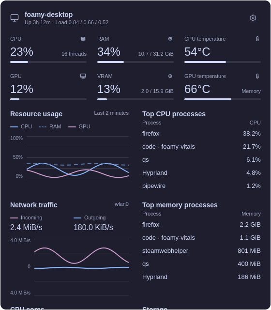

# Foamy Vitals

System activity and hardware readings.



## Install

Requires Omarchy 4.5 (it also runs on 4.0.6, in English), Bash, GNU coreutils
and findutils, and `flock`. Python 3 is needed only for Intel GPU readings,
`nvidia-smi` only for NVIDIA GPUs, and `btop` is optional. Settings paste
uses `wl-paste`, `jq` and `timeout`, provided by Omarchy.

```sh
omarchy plugin add https://github.com/foamrider/foamy-vitals.git --enable
```

## Use

- The bar shows CPU, RAM or GPU usage (the busiest one, or the one you pick) and
  turns the warning color when a usage threshold or temperature limit is reached.
- Left-click the widget to see usage, temperatures, top processes, network
  traffic, CPU threads and storage. Right-click (or **btop** in the popup) opens
  btop, if installed.
- Keyboard: Up/Down (or j/k) walk Settings, the process rows, the CPU cores strip
  and btop; Left/Right (h/l) pick a thread on the cores strip; Enter opens the
  selected item; `s` Settings, `r` refresh, `b` btop, Esc closes (or leaves
  Settings), Tab/Shift+Tab switch to the next bar panel. Hovering moves the
  same cursor.
- Open **Settings** (the cog) to choose what to show in the bar, the warning
  color, usage warning thresholds and temperature warning margins. Settings are
  saved in Omarchy's `shell.json`.

**Use theme warning colors** is on by default: warnings use the theme's urgent
color. Turn it off to use the theme's red (from its `colors.toml`), darkened on
light surfaces. Warning thresholds stay the same.

IPC: `omarchy-shell foamy.vitals open|close|toggle|settings|refresh`.

## Cost and privacy

One shell runs one sampler, however many monitors show the bar. While every
popup is closed it takes a bar-only sample every 5 seconds (usage, memory, GPU
and temperatures: about 8 ms of CPU and 4 short-lived processes on the
reference machine). While a popup is open it takes a full sample every 2
seconds (adds process rankings and their working directories: about 26 ms and 7
processes). Popup content is built on first open and does not update while
hidden. No telemetry path needs privileges, and nothing leaves the machine.
Process and directory names are shown as plain text; control characters are
removed.

Intel (`i915`/`xe`) monitoring uses Python 3 and unprivileged DRM client
counters: it reads the DRM fdinfo of the current user's processes (only file
descriptors that point at `/dev/dri`). GPU usage is the busiest engine,
normalized for its engine count. The first sample has no usage reading. GPU
memory shows private allocations, excluding shared buffers to avoid counting
them twice; it is not total VRAM or resident memory. The lowest PCI-address
Intel GPU is used when no AMD/NVIDIA load source is available. On `i915`, the
clock shows the highest current GT frequency. Unexposed temperatures remain
unavailable. Collection times out after 1.5 seconds.

NVIDIA GPUs with the proprietary driver are read with
`nvidia-smi --query-gpu`; the shutdown temperature (for thermal warnings) is
asked once per boot. The lowest PCI-address NVIDIA GPU is used when no sysfs
GPU load source is available, and load, VRAM and temperature always come from
that GPU. A GPU that runtime power management has suspended (hybrid laptops)
is never woken: it shows as 0% and "Sleeping". While every popup is closed, a
GPU that is allowed to runtime-suspend is queried at most every 30 seconds, so
polling alone never keeps it awake. Install the NVIDIA driver utilities
matching your driver if `nvidia-smi` is missing.

## Remove

```sh
omarchy plugin remove foamy.vitals
```

Removal stops metric collection. Cached readings and installed monitoring
tools remain on disk. Hardware and driver settings are not changed.

Omarchy manages the plugin entry in `shell.json`. Packages and data outside
the plugin directory are retained unless you remove them separately.

## License

Licensed under [MIT](LICENSE), with [Omarchy](LICENSE-OMARCHY) and
[Lucide](LICENSE-LUCIDE) notices.

Provided **as is**, without warranty or guaranteed support. Use at your own risk.

## Language

Language follows **Omarchy → Setup → Language** on Omarchy 4.5 (English and
Norwegian catalogs; right-to-left languages mirror the popup). Omarchy 4.0
displays the plugin in English. Missing translations fall back to English.

## Development

`kit/` holds shared components copied from [foamy-kit](https://github.com/foamrider/foamy-kit); edit them there, not here.

Shared controls come from [foamy-kit](https://github.com/foamrider/foamy-kit),
copied into `kit/` (do not edit; run its `sync.sh`).

```sh
for t in tests/*.test.js tests/*.test.cjs; do node "$t"; done
python3 -I tests/test_stats.py          # stats.sh JSON, bar mode, NVIDIA power, stderr
python3 -I tests/test_intel_stats.py
python3 tests/runtime.py both            # offscreen, 4.0 and 4.5 (needs foamy-kit)
python3 tests/i18n-runtime.py            # OMARCHY_PATH=<4.5 tree> for live switching
bash tests/kit-check.sh
python3 -I tests/bench_stats.py [--bar]  # CPU, wall time and processes per sample
```

`preview/Preview.qml` and `preview/BarPreview.qml` hold mock states for the
foamy-kit preview harness.
