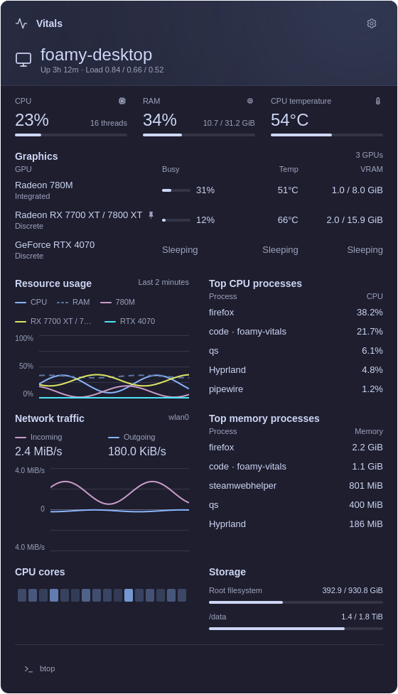

# Foamy Vitals

System activity and hardware readings.



## Install

Requires Omarchy 4.5 on an x86_64 or
aarch64 CPU, Bash and GNU coreutils. Readings come from a bundled helper
(`bin/<arch>/foamy-vitals-helper`, a static executable; other CPUs show
"This plugin's helper isn't available for this CPU."). `nvidia-smi` is needed
only for NVIDIA GPUs, and `btop` is optional. Settings paste uses `wl-paste`,
`jq` and `timeout`, provided by Omarchy.

```sh
omarchy plugin add https://github.com/foamrider/foamy-vitals.git --enable
```

## Use

- The bar shows CPU, RAM or GPU usage (the busiest one, or the one you pick) and
  turns the warning color when a usage threshold or temperature limit is reached.
- With two or more GPUs, the popup lists each one in a Graphics table, and the
  bar's GPU reading follows the busiest GPU. Click a GPU row (or press Enter on
  it) to keep the bar on that GPU; click it again to let it follow the busiest
  one. The choice is saved by PCI address and resumes when that GPU returns;
  until then the popup shows "Pinned GPU not connected".
- Left-click the widget to see usage, temperatures, top processes, network
  traffic, CPU threads and storage. Right-click (or **btop** in the popup) opens
  btop, if installed.
- Keyboard: Up/Down (or j/k) walk Settings, the GPU rows, the process rows, the
  CPU cores strip and btop; Left/Right (h/l) pick a thread on the cores strip;
  Enter opens or pins the selected item; `s` Settings, `r` refresh, `b` btop,
  Esc closes (or leaves Settings), Tab/Shift+Tab switch to the next bar panel.
  Hovering moves the same cursor.
- Open **Settings** (the cog) to choose what to show in the bar, the warning
  color, usage warning thresholds and temperature warning margins. Settings are
  saved in Omarchy's `shell.json`.

**Use theme warning colors** is on by default: warnings use the theme's urgent
color. Turn it off to use the theme's red (from its `colors.toml`), darkened on
light surfaces. Warning thresholds stay the same.

IPC: `omarchy-shell foamy.vitals open|close|toggle|settings|refresh`.

## Cost and privacy

One shell runs one sampler, however many monitors show the bar. While every
popup is closed it takes a bar-only sample every 5 seconds (usage, memory, GPU
and temperatures). While a popup is open it takes a full sample every 2 seconds
(adds process rankings and their working directories). Each sample is one run
of the bundled helper inside `timeout`, two short-lived processes (plus
`nvidia-smi` for an awake NVIDIA GPU). On the reference laptop (Intel Core
Ultra 7, about 460 processes) a bar sample costs about 45 ms of CPU and a full
one about 58 ms, most of it reading the DRM clients of the user's processes for
the Intel GPU; without an Intel GPU it is about 8 and 11 ms. Popup content is built on first open and does not update while
hidden. No telemetry path needs privileges, and nothing leaves the machine.
Process and directory names are shown as plain text; control characters are
removed.

Intel (`i915`/`xe`) monitoring uses unprivileged DRM client counters: it reads the DRM fdinfo of the current user's processes (only file
descriptors that point at `/dev/dri`). GPU usage is the busiest engine,
normalized for its engine count. The first sample has no usage reading. GPU
memory shows private allocations, excluding shared buffers to avoid counting
them twice; it is not total VRAM or resident memory. All Intel GPUs share one
scan of the user's processes, and a descriptor's fdinfo is read only when it
belongs to an Intel GPU that is awake and due a reading. On `i915`, the clock
shows the highest current GT frequency. Unexposed temperatures remain
unavailable. The process scan is bounded to one second.

Every AMD, Intel and NVIDIA (`nvidia` or `nouveau`) GPU is listed; other
display devices are ignored. Each GPU is read by its vendor's reader: AMD and
`nouveau` GPUs from sysfs, Intel GPUs by the DRM client scan above, NVIDIA GPUs
by `nvidia-smi`. Earlier versions read only one GPU, so alongside another GPU
an NVIDIA GPU adds one `nvidia-smi` call to each sample it is read in, and an
Intel GPU adds the DRM client scan (most of the Intel cost above). A GPU that
runtime power management has suspended (hybrid laptops) is never woken: it
shows as 0% and "Sleeping". While every popup is closed, a non-integrated GPU
that is allowed to runtime-suspend is read at most every 30 seconds, so
polling alone never keeps it awake; the samples in between skip its call. AMD
and Intel GPUs driving a connected display are exempt, since the display keeps
them awake.
An integrated AMD GPU's memory is shown as "GPU memory": its VRAM carve-out
plus GTT, the system memory it borrows.

NVIDIA GPUs with the proprietary driver are read with one
`nvidia-smi --query-gpu` call that covers every awake NVIDIA GPU; the shutdown
temperature (for thermal warnings) is asked once per boot. Install the NVIDIA
driver utilities matching your driver if `nvidia-smi` is missing.

## Verifying the helper binaries

`bin/x86_64/foamy-vitals-helper` and `bin/aarch64/foamy-vitals-helper` are compiled from the Rust
source in this repository: `native/`, the shared crate in
`kit/rust/foamy-helper/`, the dependencies locked in `Cargo.lock` and the
toolchain pinned in `rust-toolchain.toml`. The build is reproducible, so you
can rebuild both binaries yourself and check that they are byte-identical to
the committed files.

`native/native.pin` records the foamy-kit release that built them (`kit`), the
Rust toolchain (`toolchain`), a hash of every build input (`source`) and the
SHA-256 of each binary. The rebuild uses that foamy-kit release's
`tools/build-native.sh`. You need `git`, `rustup`, Python 3.11 or newer and
`file`; Omarchy isn't needed.

```sh
git clone https://github.com/foamrider/foamy-vitals.git
cd foamy-vitals
pin=native/native.pin
rustup toolchain install "$(awk '$1 == "toolchain" { print $2 }' $pin)" \
  --profile minimal --target x86_64-unknown-linux-musl,aarch64-unknown-linux-musl
# foamy-kit 0.5.2 (`kit` in native.pin), at the commit its v0.5.2 tag names:
git clone https://github.com/foamrider/foamy-kit.git ../foamy-kit &&
  git -C ../foamy-kit checkout -q --detach cc3e46f0fae443701c81793cf9f49890b39b37c1 &&
  ../foamy-kit/tools/build-native.sh . --verify
```

The last command builds both binaries from scratch in `~/.cache/foamy-native/`
(nothing is written to the checkout) and compares them byte for byte with
`bin/`. It also checks that the kit files are unmodified copies of that
foamy-kit release and that `native.pin` matches the source. It ends with
`verify OK (foamy-vitals-helper, <toolchain>, both arches reproducible)`; any
difference is reported with both hashes. `git -C ../foamy-kit describe --tags`
prints `v0.5.2`, the release `native.pin` names. To check a release the
marketplace lists, run `git checkout <commit>` right after `cd`.

<!-- Maintainers: when native.pin's kit changes, set the commit above to
     `git -C foamy-kit rev-parse v<kit>^{commit}`. -->

## Remove

```sh
omarchy plugin remove foamy.vitals
```

Removal stops metric collection. Cached readings and installed monitoring
tools remain on disk. Hardware and driver settings are not changed.

Omarchy manages the plugin entry in `shell.json`. Packages and data outside
the plugin directory are retained unless you remove them separately.

## License

Licensed under [MIT](LICENSE), with [Omarchy](LICENSE-OMARCHY) and
[Lucide](LICENSE-LUCIDE) notices.

Provided **as is**, without warranty or guaranteed support. Use at your own risk.

## Language

Language follows **Omarchy → Setup → Language** (English and Norwegian
catalogs; right-to-left languages mirror the popup). Missing translations fall
back to English.

## Development

`kit/` holds shared components copied from [foamy-kit](https://github.com/foamrider/foamy-kit); edit them there, not here.

Shared controls come from [foamy-kit](https://github.com/foamrider/foamy-kit),
copied into `kit/` (do not edit; run its `sync.sh`).

The stats helper is the Rust crate in `native/` (its contract is the comment
at the top of `native/src/main.rs`). The binaries in `bin/` are committed so
the plugin installs without a build. To change the helper you need rustup with
the toolchain from `rust-toolchain.toml`; then rebuild both architectures and
commit `bin/` and `native/native.pin` with the change:

```sh
~/GitHub/Personal/foamy-kit/tools/build-native.sh . --test   # fmt, clippy, cargo tests
~/GitHub/Personal/foamy-kit/tools/build-native.sh .          # bin/x86_64, bin/aarch64, native.pin
~/GitHub/Personal/foamy-kit/tools/build-native.sh . --verify # clean rebuild is byte-identical
```

Tests (Python 3 and Node are needed only here):

```sh
for t in tests/*.test.js tests/*.test.cjs; do node "$t"; done
python3 -I tests/test_stats.py          # helper JSON, bar mode, NVIDIA power, state directory
python3 -I tests/test_intel_stats.py    # Intel DRM fdinfo readings
FOAMY_HELPER='["bin/aarch64/foamy-vitals-helper", "stats"]' python3 -I tests/test_stats.py  # aarch64 via qemu
FOAMY_VITALS_REFERENCE='["<dir>/stats.sh"]' python3 -I tests/compare_stats.py  # same bytes as #2's stats.sh (intel_stats.py beside it)
python3 tests/runtime.py                 # offscreen on 4.5 (needs foamy-kit)
python3 tests/i18n-runtime.py            # live switching; OMARCHY_PATH for another tree
bash tests/kit-check.sh
python3 -I tests/bench_stats.py [--bar]  # CPU, wall time and processes per sample
python3 -I tests/bench_stats.py --fixture nvidia [--bar]  # fake trees: amd, nvidia, nvidia2, amd-nvidia, intel-nvidia, intel-amd
```

The runtime test targets Omarchy 4.5, the installed `/usr/share/omarchy/shell`
(`FOAMY_HOST_45` selects another shell tree). `runtime.py 4.0` and
`runtime.py both` run 4.0 only against an Omarchy 4.0 shell tree in
`FOAMY_HOST_40`, and print a SKIP line without one.

`preview/Preview.qml` and `preview/BarPreview.qml` hold mock states for the
foamy-kit preview harness.
